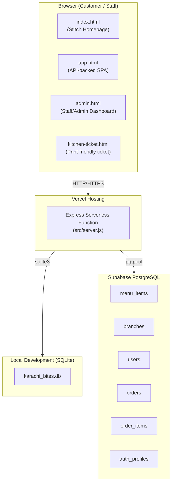
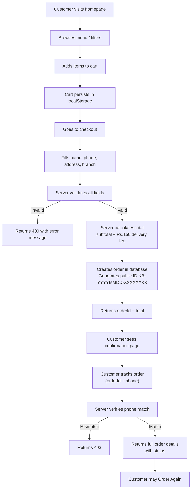
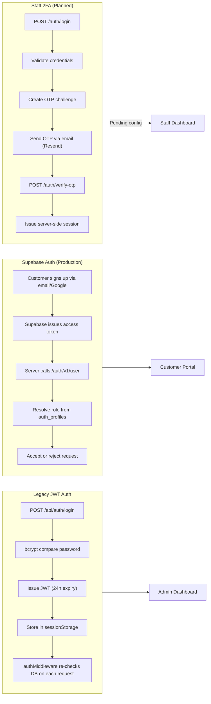
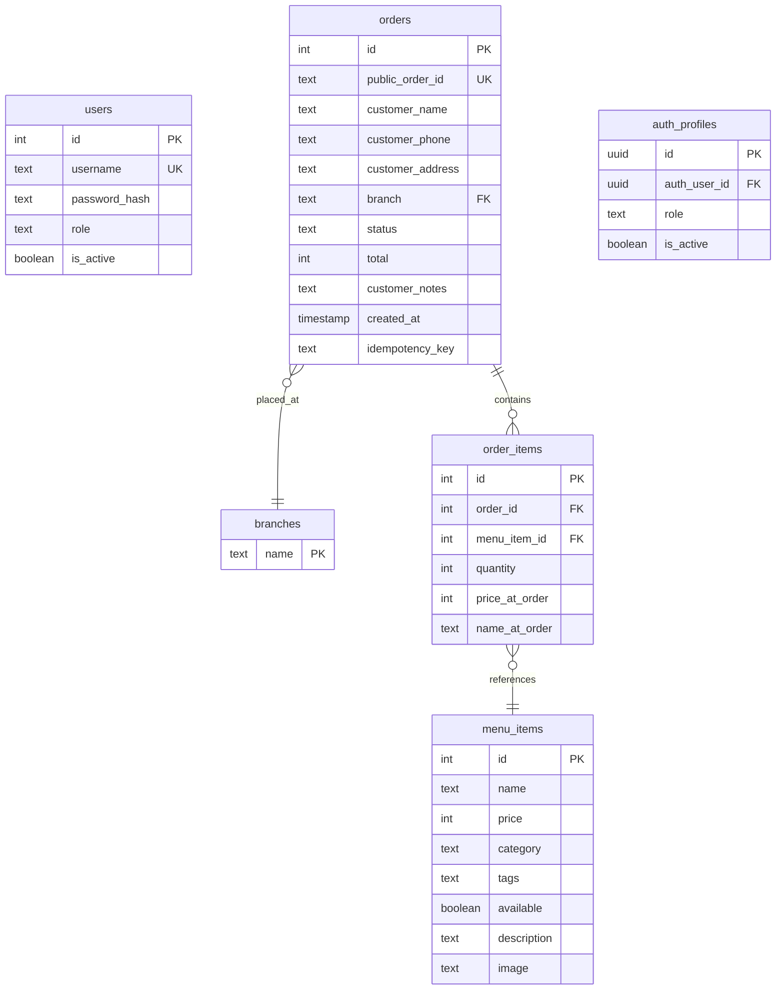
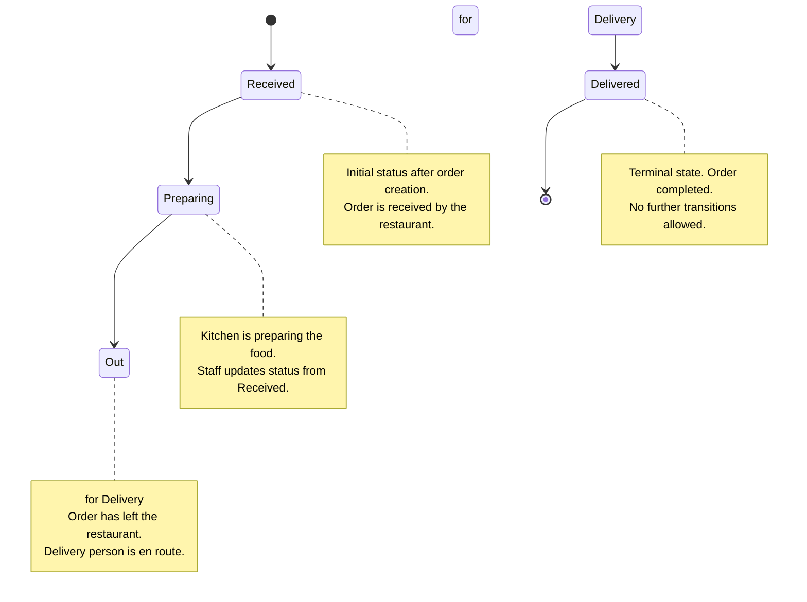
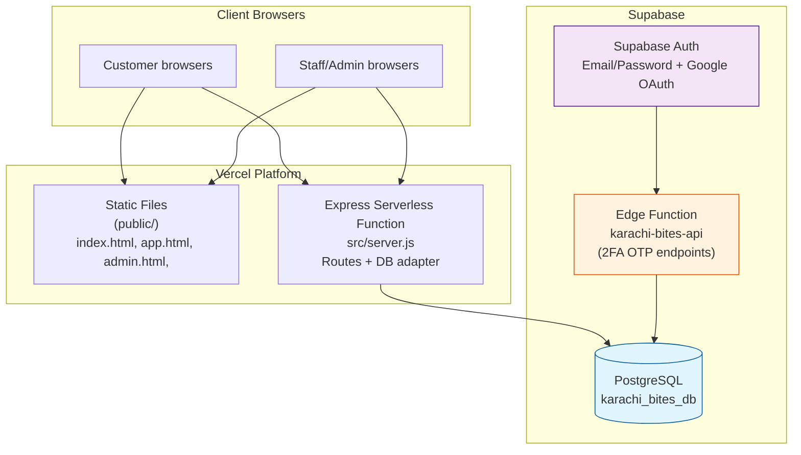
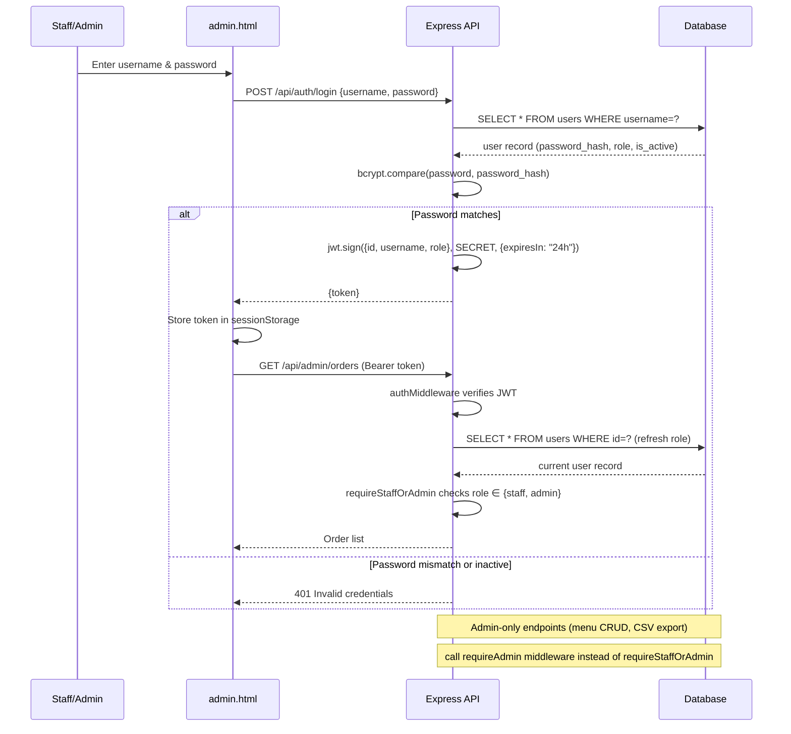

# Karachi Bites — Diagrams

All diagrams below are written in Mermaid syntax and reflect the actual implementation of the project.

---

# 1. System Architecture

---

# 2. Customer Ordering Workflow

---

# 3. Authentication and 2FA Flow

---

# 4. Database Entity Relationship Diagram (ERD)

---

# 5. Order Status Lifecycle

---

# 6. Deployment Architecture

---

# 7. Staff/Admin Authorization Flow

